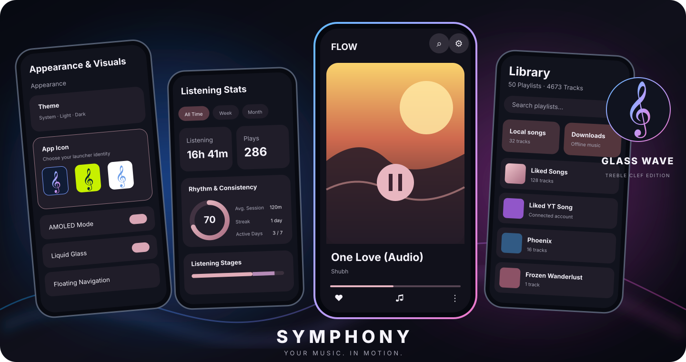

<p align="center">
  
</p>

<p align="center"><strong>Your music. In motion.</strong><br/>
A native Android music player built around immersive Flow discovery, personalisation and playback control.</p>

<p align="center">
  <a href="https://github.com/smrutiranjandev0p/SYMPHONY/releases/tag/1.4"></a>
  <a href="https://github.com/smrutiranjandev0p/SYMPHONY/stargazers"></a>
  <a href="https://github.com/smrutiranjandev0p/SYMPHONY/network/members"></a>
  <a href="https://github.com/smrutiranjandev0p/SYMPHONY/issues"></a>
</p>

<p align="center">
  <a href="https://github.com/smrutiranjandev0p/SYMPHONY/releases/tag/1.4"><strong>⬇ Download v1.4 APKs</strong></a>
  &nbsp;·&nbsp;
  <a href="#features"><strong>Explore features</strong></a>
  &nbsp;·&nbsp;
  <a href="#community"><strong>Contribute</strong></a>
</p>

**SYMPHONY 1.4** brings together four core destinations — **Flow, Home, Statistics and Library** — in a native Android listening experience. Discover music in an artwork-first player, shape the app's appearance, review listening activity and organise your collection.

## Download SYMPHONY 1.4

The official v1.4 release is published on GitHub:

<p align="center">
  <a href="https://github.com/smrutiranjandev0p/SYMPHONY/releases/tag/1.4">
    
  </a>
</p>

Choose an APK from the release **Assets**:

| Package | When to choose it |
| --- | --- |
| `SYMPHONY-v1.4-universal.apk` | Recommended compressed universal build for most supported Android devices |
| `SYMPHONY-v1.4-android7.apk` | Legacy-compatible Android 7+ variant |
| `SYMPHONY-v1.4-universal-uncompressed.apk` | Uncompressed universal package |
| `SYMPHONY-v1.4-vivo-origin.apk` | Vivo OriginOS-targeted variant |

Check the release notes for compatibility details before installing. If unsure, start with the standard **universal APK**. The release includes `SHA256SUMS.txt` for checksum verification.

[View v1.4 release and APK assets](https://github.com/smrutiranjandev0p/SYMPHONY/releases/tag/1.4) · [All releases](https://github.com/smrutiranjandev0p/SYMPHONY/releases)

## The SYMPHONY experience

### Flow — discover and listen
An immersive, artwork-first listening surface with swipe-led track discovery, a prominent central play/pause control, track actions and the Party Torch entry point. Flow keeps the music and its artwork at the centre of the screen.

### Appearance & Visuals
Personalise the look and feel with:
- System, Light and Dark theme choices
- Selectable launcher icon editions: Glass Wave, Desktop, Pure White and Obsidian Black
- SYMPHONY Signature Theme
- AMOLED mode for a pure-black dark appearance
- Dynamic Color and Liquid Glass options
- Floating Navigation Dock option

Some appearance options depend on Android version, launcher support and device rendering.

### Listening Statistics
Review listening activity with time filters and listening summaries. The statistics experience includes plays, tracks, artists, albums, listening rhythm, listening stages and personal records. Values shown in the app reflect the local account/session data and available scrobble history; they are not universal service-wide counts.

### Library
Organise and revisit your collection with library filters and sections for local songs, downloads, liked songs, playlists and connected-source collections. Playlist search, sorting and playlist generation entry points help you navigate larger libraries.

## Features

- YouTube Music discovery and playback integrations
- Local music library and offline downloads
- Playlists, favourites, queue and playback history
- Lyrics and synchronised lyrics where available
- Spotify playlist import and Last.fm scrobbling
- Equalizer, AutoEQ, Automix and advanced audio output options
- Google Cast, Android Auto, widgets and Android media controls
- Theme, accent, Liquid Glass and launcher icon customisation
- Party Torch with audio-reactive flash pulses and a long-press Light Studio for supported flash-strength control

**Party Torch safety and compatibility:** the feature is opt-in and requests relevant permissions when enabled. Flash-strength adjustment is shown only on compatible hardware; devices without adjustable torch support retain standard torch behaviour. Pulses are rate-limited, and the torch is turned off when playback pauses or Flow is left. Avoid staring into or directing a flashing light at anyone.

Feature availability can vary by device, Android version, connected service, music source, credentials and network conditions.

## Technology

| Layer | Stack |
| --- | --- |
| App language | Kotlin |
| UI | Jetpack Compose, Material 3 |
| Playback | AndroidX Media3 / ExoPlayer |
| Async work | Kotlin Coroutines and Flow |
| Dependency injection | Hilt |
| Local persistence | Room, DataStore |
| Networking | OkHttp and Retrofit |
| Native audio | C++, CMake and included USB audio driver |

## Build locally

### Requirements
- Android Studio
- JDK 17
- Android SDK 37
- Android 10 / API 29 or newer for the standard app configuration

### Clone
```bash
git clone https://github.com/smrutiranjandev0p/SYMPHONY.git
cd SYMPHONY
```

### Build a debug APK

**Windows PowerShell**
```powershell
.\gradlew.bat assembleDebug
```

**macOS / Linux**
```bash
./gradlew assembleDebug
```

The APK is generated under `app/build/outputs/apk/debug/`.

### Release builds
Release builds must be signed with the project's release keystore. Configure signing values through environment variables or local Gradle properties. Never commit keystores, passwords, API tokens or other credentials.

GitHub Actions contains the build and release workflows. Published releases and in-app update checks use this repository's GitHub Releases page.

## Project structure

```text
SYMPHONY/
├── app/
│   └── src/main/
│       ├── java/com/symphony/app/
│       │   ├── data/       # Music sources, repositories and persistence
│       │   ├── playback/   # Playback service, queue and audio engine
│       │   ├── ui/         # Compose screens and components
│       │   └── ...
│       ├── res/            # Android resources and launcher icons
│       └── cpp/            # Native components
├── audio/                  # Included audio driver module
├── assets/                 # Repository branding and showcase artwork
├── .github/workflows/      # CI, APK builds and release automation
├── CHANGELOG.md
└── README.md
```

## Versioning and verification

The current published release is **1.4** (Android `versionCode 37`, `versionName 1.4`). See [CHANGELOG.md](CHANGELOG.md) for release history. The v1.4 Android build workflow and release publication workflow completed successfully. CI success confirms automated build and publication; installation, upgrade behaviour and hardware-specific features still require physical-device testing.

## Project principles

- Keep the listening experience central.
- Keep navigation clear and consistent.
- Prefer reliable playback and honest source/quality reporting.
- Keep release signing material and private credentials out of Git.
- Verify builds before describing a change as shipped.

## Community

SYMPHONY is an independent project maintained by **[smrutiranjandev0p](https://github.com/smrutiranjandev0p)**.

- ⭐ [Star the repository](https://github.com/smrutiranjandev0p/SYMPHONY/stargazers) if you genuinely find it useful.
- 🐛 [Report a bug](https://github.com/smrutiranjandev0p/SYMPHONY/issues/new/choose) with your device model, Android version and reproduction steps.
- 💡 [Suggest an improvement](https://github.com/smrutiranjandev0p/SYMPHONY/issues).
- 🤝 Read [CONTRIBUTING.md](CONTRIBUTING.md) before opening a pull request.

## Credits & inspiration

SYMPHONY's Flow screen takes inspiration from the immersive, swipe-led music discovery interaction popularised by Resso. SYMPHONY is an independent project and is not affiliated with or endorsed by Resso, Vivo, YouTube, Spotify or other referenced services.

## Maintainer

**Made with care by [Smruti Ranjan Behera](https://github.com/smrutiranjandev0p).**

## License

See [LICENSE](LICENSE) for the project's license and distribution terms.

---

<p align="center"><strong>SYMPHONY — Press play. Follow the flow.</strong><br/>If it adds something to your listening experience, consider leaving a ⭐.</p>
