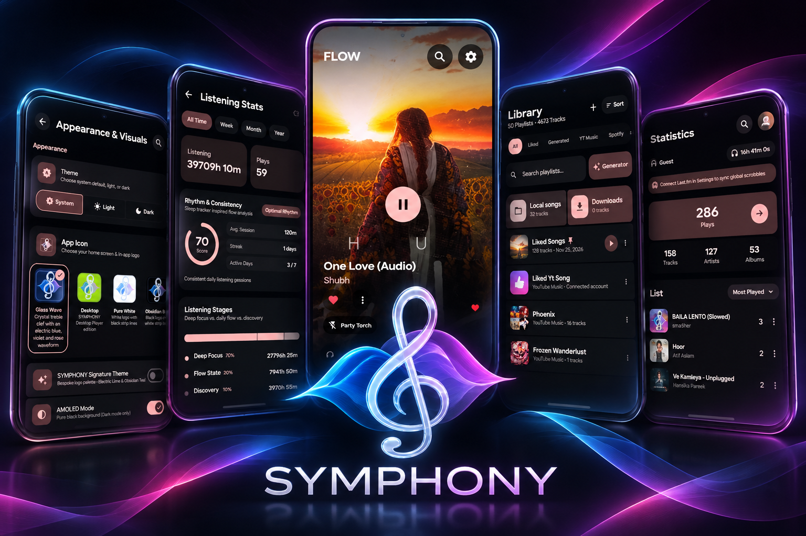

<p align="center">
  <!-- LOCKED BRAND ASSET: Keep this exact banner path unless the owner explicitly requests a replacement. -->
  
</p>

<p align="center"><strong>Your music. In motion.</strong><br/>
A native Android music player built around immersive Flow discovery, flexible playback and personalisation.</p>

<p align="center">
  <a href="https://github.com/smrutiranjandev0p/SYMPHONY/releases/tag/2.1"></a>
  <a href="https://github.com/smrutiranjandev0p/SYMPHONY/stargazers"></a>
  <a href="https://github.com/smrutiranjandev0p/SYMPHONY/network/members"></a>
  <a href="https://github.com/smrutiranjandev0p/SYMPHONY/issues"></a>
</p>

<p align="center">
  <a href="https://github.com/smrutiranjandev0p/SYMPHONY/actions"><strong>View build artifacts</strong></a>
  &nbsp;·&nbsp;
  <a href="#features"><strong>Explore features</strong></a>
  &nbsp;·&nbsp;
  <a href="CHANGELOG.md"><strong>What's new</strong></a>
  &nbsp;·&nbsp;
  <a href="#community"><strong>Contribute</strong></a>
</p>

## About SYMPHONY

**SYMPHONY 2.1** is an independent, native Android music player designed around an artwork-first listening experience. Its four primary destinations are **Flow, Home, Statistics and Library**. The Flow experience uses swipe-led, full-screen music discovery inspired by the interaction style popularised by Resso, while keeping SYMPHONY's own visual identity, playback system and feature set.

## Download

**SYMPHONY 2.1 is released.** Download the recommended package for your device below, or open the [v2.1 release page](https://github.com/smrutiranjandev0p/SYMPHONY/releases/tag/2.1) for release notes and all assets.

| Package | Compatibility | Download |
| --- | --- | --- |
| Universal (recommended) | Android 10–16+ | [Download APK](https://github.com/smrutiranjandev0p/SYMPHONY/releases/download/2.1/SYMPHONY-v2.1-universal.apk) |
| vivo Origin Island edition | vivo phones running supported OriginOS builds | [Download APK](https://github.com/smrutiranjandev0p/SYMPHONY/releases/download/2.1/SYMPHONY-v2.1-vivo-origin.apk) |
| Android 7 legacy | Android 7.0–9.0 | [Download APK](https://github.com/smrutiranjandev0p/SYMPHONY/releases/download/2.1/SYMPHONY-v2.1-android7.apk) |
| Universal uncompressed | Android 10–16+ | [Download APK](https://github.com/smrutiranjandev0p/SYMPHONY/releases/download/2.1/SYMPHONY-v2.1-universal-uncompressed.apk) |
| SHA-256 checksums | Verify downloaded release assets | [SHA256SUMS.txt](https://github.com/smrutiranjandev0p/SYMPHONY/releases/download/2.1/SHA256SUMS.txt) |

**Which should I install?** Use the Universal APK on most Android 10+ devices. The vivo Origin Island package is a separate build for supported vivo OriginOS integrations; it installs as a separate app and does not share app data with the universal package. Use the Android 7 legacy package only on Android 7–9. The uncompressed universal package is provided as an alternative build, not as the default recommendation.

On Android 7–11, some Liquid Glass/live-blur effects fall back to a translucent acrylic surface because the platform does not support the same rendering path.

## The experience

### Flow
- **Shared playback state (v1.5):** Flow reflects the active YouTube Music track started from Home and avoids issuing a new playback command from its restored initial pager position when returning from Settings.
- Full-screen, artwork-first music discovery with swipe navigation.
- Prominent playback controls, track actions and lyrics access.
- Party Torch entry point with opt-in audio-reactive flash behaviour and Light Studio on compatible hardware.
- Flow follows queue auto-advance while retaining manual swipe selection.
- **Live radio discovery:** When Flow is the active playback source, its vertical pager observes the live playback queue, including recommendations appended by radio continuation, so manually swiping can reach tracks added after playback starts.

### Home
A home surface for discovery, recommendations and music entry points. Available cards and content depend on configured sources, network access and account state.

### Statistics
Listening summaries and history views with time filters, play activity, tracks, artists, albums, listening rhythm and personal records. Displayed totals depend on locally available activity and connected scrobble history.

### Library
A place to revisit local songs, downloads, liked tracks, playlists and connected-source collections, with browsing and organisation tools.

## Features

### Music and playback
- YouTube Music search, discovery and playback integration.
- Stream resolution prioritises the InnerTubeX integration, with the existing NewPipe/local resolver path retained as fallback.
- Local music browsing and offline downloads.
- Queue, playback history, liked tracks and playlists.
- Lyrics and synchronised lyrics when a supported source provides them.
- Spotify playlist import and Last.fm scrobbling.
- Google Cast, Android Auto, Android media notifications and headset/Bluetooth controls.

### Audio
- Equalizer and AutoEQ support.
- Automix transitions and playback controls.
- Native C++/Oboe audio processing path.
- USB audio and bit-perfect output options on compatible hardware.
- Output quality and available processing depend on the source, device, route and connected audio hardware.

### Personalisation
- System, Light and Dark appearance modes.
- Purple Glass, Desktop, Pure White and Obsidian Black launcher icon editions, each backed by its own launcher artwork.
- SYMPHONY Signature Theme, AMOLED appearance and Dynamic Color options.
- Liquid Glass surfaces with platform-aware fallbacks.
- Floating Navigation Dock option.
- Additional player and lyrics presentation controls.

### Extras
- Home-screen widgets and Android system media controls.
- Listen Together / SYMPHONY Jam features where configured.
- Discord Rich Presence integration.
- Party Torch is opt-in; flash strength controls appear only on supported hardware. Flash pulses are rate-limited and stop when playback pauses or Flow is left. Do not look directly into a flashing light or direct it at another person.

Feature availability can vary by Android version, device, hardware, connected services, account permissions, credentials, network conditions and source-side changes.

## Updates

SYMPHONY checks the repository's GitHub Releases endpoint for newer versions. A new-version prompt is shown when a release newer than the installed app is available; dismissing a version suppresses repeat prompts for that same version. You can also check manually from the app's update/settings area. Re-uploading assets to an existing release tag without increasing the app version does not constitute a newer app version.

## Technology

| Area | Technology |
| --- | --- |
| Language | Kotlin |
| UI | Jetpack Compose, Material 3 |
| Playback | AndroidX Media3 / ExoPlayer |
| Stream extraction | InnerTubeX integration, NewPipe Extractor and local resolver fallback |
| Async | Kotlin Coroutines and Flow |
| Dependency injection | Hilt |
| Persistence | Room and DataStore |
| Networking | OkHttp, Retrofit and Jsoup |
| Native audio | C++, JNI, CMake and Google Oboe |
| Build | Gradle, Android Gradle Plugin and GitHub Actions |

## Build locally

### Requirements
- Android Studio
- JDK 17
- Android SDK Platform 37
- Android NDK and CMake versions required by the project

The standard app configuration uses Android 10 / API 29 as its minimum SDK. The repository also defines a legacy Android 7+ build configuration.

### Clone
```bash
git clone https://github.com/smrutiranjandev0p/SYMPHONY.git
cd SYMPHONY
```

### Build a debug APK

Windows PowerShell:
```powershell
.\gradlew.bat assembleDebug
```

macOS / Linux:
```bash
./gradlew assembleDebug
```

The debug APK is generated under `app/build/outputs/apk/debug/`.

### Run unit tests
```bash
./gradlew testDebugUnitTest
```

### Release builds
Release variants require the project's release signing key. Configure signing through the documented Gradle environment variables or local Gradle properties. Never commit keystores, passwords, API tokens or local secret files.

GitHub Actions contains the Android build and release workflows. CI success verifies the automated tasks that ran; it does not replace installation, upgrade and hardware testing on physical devices.

## Project structure

```text
SYMPHONY/
├── app/
│   └── src/main/
│       ├── java/com/symphony/app/
│       │   ├── data/       # Sources, repositories and persistence
│       │   ├── playback/   # Player, stream resolution and audio pipeline
│       │   ├── ui/         # Compose screens and components
│       │   └── ...
│       ├── res/            # Android resources and launcher icons
│       └── cpp/            # Native audio and DSP components
├── audio/                  # USB audio driver module
├── assets/                 # Branding and showcase artwork
├── docs/                   # Design and implementation notes
├── .github/workflows/      # CI, APK builds and release automation
├── AGENTS.md
├── CHANGELOG.md
├── DESIGN.md
└── README.md
```

## Current version and verification

- **Version:** SYMPHONY 2.1 — published on 2026-11-26.
- **Android version metadata:** `versionName 2.1`, `versionCode 40`.
- **Release workflow:** [#45819793575](https://github.com/smrutiranjandev0p/SYMPHONY/actions/runs/45819793575) completed successfully, including universal, uncompressed universal, vivo Origin Island and Android 7 legacy APK builds, signature verification, checksum generation and GitHub Release publication.
- **Playback stack:** AndroidX Media3 1.9.0 with Jellyfin FFmpeg decoder 1.9.0+1; InnerTubeX and NewPipe fallback paths retained.
- **Launcher editions:** Purple Glass, Desktop, Pure White and Obsidian Black artwork resources are included. OEM launcher refresh and icon switching should still be checked on the target device.
- **Device verification:** CI build and publication succeeded. Physical-device installation, in-place upgrade, icon switching and real-world playback performance remain device-specific checks.

## Project principles

- Keep the listening experience central.
- Keep navigation clear and consistent.
- Prefer reliable playback and honest source/quality reporting.
- Respect third-party service terms and open-source licences.
- Keep release signing material and private credentials out of Git.
- Verify builds before describing a change as shipped.

## Community

SYMPHONY is an independent project maintained by **[Smruti Ranjan Behera](https://github.com/smrutiranjandev0p)**.

- ⭐ [Star the repository](https://github.com/smrutiranjandev0p/SYMPHONY/stargazers).
- 🐛 [Report a bug](https://github.com/smrutiranjandev0p/SYMPHONY/issues/new/choose) with your app version, device, Android version and reproduction steps.
- 💡 [Suggest an improvement](https://github.com/smrutiranjandev0p/SYMPHONY/issues).
- 🤝 Read [CONTRIBUTING.md](CONTRIBUTING.md) before opening a pull request.
- 🔐 Read [SECURITY.md](SECURITY.md) before reporting a vulnerability.

## Credits and inspiration

SYMPHONY's Flow interaction takes inspiration from the swipe-led music discovery experience popularised by Resso. The app's identity, implementation and broader feature set are independent. SYMPHONY is not affiliated with or endorsed by Resso, vivo, YouTube, Spotify or any other referenced service.

## Maintainer

**Created and maintained by [Smruti Ranjan Behera](https://github.com/smrutiranjandev0p).**

## License

See [LICENSE](LICENSE) and the applicable third-party notices for licensing and distribution terms.

---

<p align="center"><strong>SYMPHONY — Press play. Follow the flow.</strong><br/>If it adds something to your listening experience, consider leaving a ⭐.</p>
